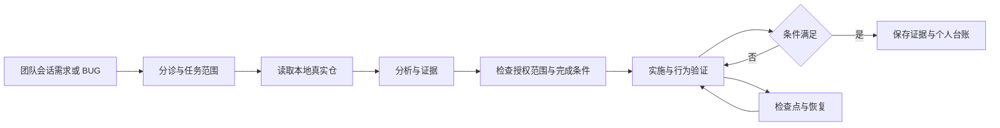

# nuwax-stack

把团队会话里的需求和 BUG，转成有代码依据、可继续处理的任务。技能配置到现有 nuwax Agent，由平台提供会话和本地工具通道。



## 一个技能包

只安装、绑定和升级 [nuwax-stack](skills/nuwax-stack/SKILL.md)，当前版本 `0.4.0`。内部按任务读取模块，共用一个包和版本：

| 内部模块 | 作用 |
| --- | --- |
| [分诊](skills/nuwax-stack/references/triage.md) | 识别任务、范围与验收条件 |
| [IM 收件](skills/nuwax-stack/references/im-inbox.md) | Agent 主动读取群消息、结构化提及筛选与持久接手 |
| [真实仓分析](skills/nuwax-stack/references/analyze-repo.md) | 读取真实 HEAD 和代码因果 |
| [自主循环](skills/nuwax-stack/references/autonomous-run.md) | 实施、修正和检查点 |
| [行为验证](skills/nuwax-stack/references/verify.md) | 验证真实行为、保存证据 |
| [断点接手](skills/nuwax-stack/references/session-pickup.md) | 从既有记录恢复，避免重复工作 |
| [个人台账](skills/nuwax-stack/references/task-ledger.md) | 来源只读、维护个人进度 |
| [决策记录](skills/nuwax-stack/references/decision-log.md) | 记录结论与核验通知身份 |

总入口按需读取模块。`scripts/` 包含原有三个助手与离线 IM 消息筛选脚本，引用全部在同一个 ZIP 内，没有对子技能安装的依赖。

生产专用 Agent 已从七个 Skill 绑定收敛为一个。合并前的真实执行、失败修复、跨会话恢复和唤醒证据见[自主验收记录](docs/autonomy-acceptance-20261020.md)；结构调整见[统一技能迁移](docs/unified-skill-20261020.md)。生产工作电脑 MBP128 已完成本机执行验收并配置固定工作目录，见[工作电脑接入记录](docs/work-computer-20261020.md)。正式 IM 与群触发的剩余边界单独记录。

团队原始文档始终只读，个人进度只写明确登记的独立台账。测试和构建可能写产物，须在任务授权的隔离环境执行。源码授权不扩大到源文档或其他人的工作区。

## 本地验收

需要 Python 3.10+，无第三方运行时依赖。

```bash
python3 -B -m unittest discover -s tests -v
python3 -B scripts/sync_platform.py --dry-run
```

预演不读取凭据、不访问网络，生成一个 `dist/nuwax-stack.zip`、`dist/manifest.json` 和 `dist/platform-preview.json`。把该 ZIP 用于平台导入；实际平台导入与 Agent 绑定步骤见 [配置说明](docs/agent-setup.md)。

将 [配置样例](config/agent-context.example.json) 按真实环境填写到平台 Agent 的上下文中。该 JSON 是配置说明，不是平台已经实现的导入接口。仓库路径、电脑、会话和工具必须来自实际配置。

## 平台同步

脚本支持创建或更新技能草稿、导出逐文件比对、显式发布。默认离线；[同步指南](docs/platform-sync.md) 说明参数、凭据和失败恢复。

当前交付的验证范围见 [验收记录](docs/acceptance.md)。平台技能发布、真实团队会话消息和云侧读取本机仓库需要在目标环境单独验收。

## 设计来源

参考 [pstack 官方入口](https://github.com/cursor/plugins/blob/main/pstack/skills/poteto-mode/SKILL.md) 的任务路由、真实行为验证和决策轨迹，按 nuwax 已有会话与本地工具能力重新设计。`nuwa-sdlc-kit` 可继续作为目标仓的治理约束，本项目不依赖它的安装或源码。

接入细节来自 `nuwa-cli` 随装的 `nuwax-platform-access` 契约，使用时以目标环境当前工具定义为准。
